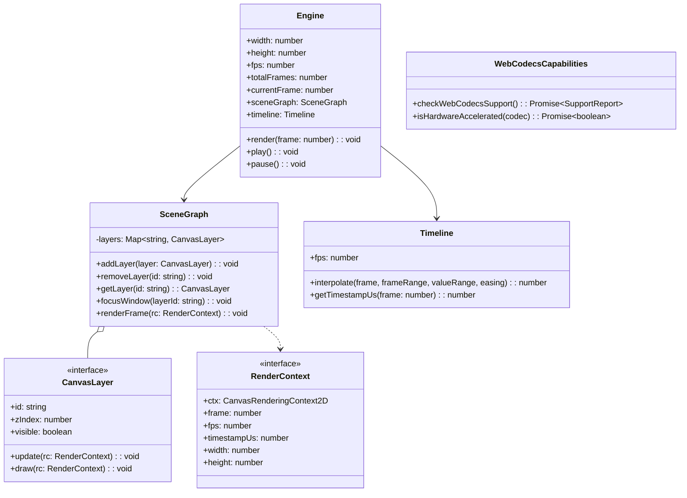
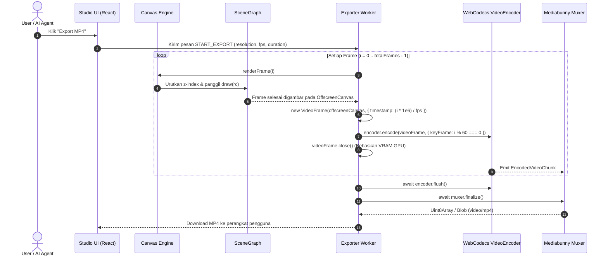

# Analisis Arsitektur & Rencana Eksekusi: agentika-canvas

Dokumen ini menyajikan analisis komprehensif mengenai arsitektur teknis dari proyek **agentika-canvas** berdasarkan spesifikasi pada [PRD.md](file:///workspace/agentika-canvas/PRD.md) dan [ROADMAP.md](file:///workspace/agentika-canvas/ROADMAP.md). Dokumen ini membedah pergeseran paradigma dari *server-side DOM video generation* (Remotion) menuju *client-side deterministic Canvas + WebCodecs*, arsitektur teknologi pendukung, serta cetak biru teknis implementasi untuk **Phase 1** dan **Phase 2**.

---

## 1. Analisa Masalah Remotion vs Solusi Canvas + WebCodecs

Produksi video terprogram (*programmatic video generation*) secara konvensional mengandalkan pustaka berbasis React DOM seperti **Remotion**. Namun, dalam skenario otomatisasi video berbasis naskah AI dan antarmuka desktop modern (misalnya gaya visual *Nesi Nowware* atau Kuis Otomatis), ditemukan tiga kelemahan mendasar:

```mermaid
flowchart TD
    subgraph Paradigma_Lama["Paradigma Lama: Remotion (Server & DOM)"]
        A1["Naskah / State"] --> B1["React DOM Tree"]
        B1 --> C1["Headless Chrome / Puppeteer (Server / Railway)"]
        C1 --> D1["FFmpeg Process (CPU/RAM Berat, $6 - $20+/bulan)"]
        D1 --> E1["MP4 Output File"]
        B1 -.->|"Kendala: z-index diabaikan saat capture DOM"| F1["Urutan layer kaku / DOM re-ordering lambat"]
    end

    subgraph Paradigma_Baru["Paradigma Baru: agentika-canvas (100% In-Browser $0)"]
        A2["Naskah AI / CLI"] --> B2["SceneGraph + Canvas Layers"]
        B2 --> C2["HTML5 Canvas 2D / OffscreenCanvas"]
        C2 --> D2["WebCodecs API (VideoEncoder Hardware Acceleration)"]
        D2 --> E2["Mediabunny / MP4 Muxer ($0 Server, 100% Client-Side)"]
        B2 -.->|"Solusi: Dynamic z-index via focusWindow()"| F2["Layer diurutkan fleksibel per-frame"]
    end
```



### 1.1. Biaya Server & Dependensi FFmpeg (Cloud Server vs USD 0 In-Browser)
* **Kelemahan Remotion**:
  * Untuk menghasilkan file MP4, Remotion memerlukan lingkungan server yang menjalankan instance Headless Chromium (Puppeteer) dan proses biner FFmpeg.
  * Infrastruktur server (seperti Railway, AWS Lambda, atau container hosting lainnya) memakan biaya berkisar **USD 6 hingga USD 20+ per bulan** per instans, dengan latensi transfer file video berukuran ratusan megabyte ke storage cloud.
  * Ketika volume video bertambah, biaya komputasi dan memori CPU/RAM melonjak tajam karena encoding video di server bersifat intensif CPU.
* **Solusi agentika-canvas (WebCodecs + Mediabunny)**:
  * **Biaya Server USD 0**: Seluruh proses rendering kanvas, pengkodean video, dan pembungkusan (*muxing*) dijalankan secara lokal di peramban klien (*in-browser*).
  * **Akselerasi Perangkat Keras**: Menggunakan **WebCodecs API** (`VideoEncoder`), komputasi pengkodean memanfaatkan GPU perangkat pengguna, menghasilkan kecepatan encoding hingga **~804 frame/detik** tanpa membebani server backend.

### 1.2. Keterbatasan `z-index` pada Render Browser Berbasis DOM
* **Kelemahan Remotion**:
  * Dalam mesin *browser renderer* berbasis DOM pada Remotion, properti CSS `z-index` sering kali tidak dihormati secara andal dalam *stacking context* dinamis atau urutan tumpukan murni ditentukan oleh urutan penulisan elemen di pohon JSX (elemen di baris bawah menimpa elemen di baris atas).
  * Pada animasi video bertema desktop modern (seperti macOS UI) di mana terdapat banyak jendela aplikasi (*windows*) yang saling tumpuk dan harus berpindah ke latar depan saat kursor mengekliknya, developer terpaksa memanipulasi susunan array komponen React pada setiap state perubahan. Hal ini memicu *re-render* DOM yang berat, rentan *race-condition*, dan menyulitkan kode animasi deterministik.
* **Solusi agentika-canvas (HTML5 Canvas + SceneGraph)**:
  * Kanvas 2D menggambar piksel secara sekuensial. Urutan tampilan ditentukan oleh urutan eksekusi perintah `draw()`.
  * Melalui arsitektur **SceneGraph**, setiap elemen visual didefinisikan sebagai `CanvasLayer` dengan nilai `zIndex: number`.
  * Saat interaksi jendela terjadi, sistem cukup memanggil helper `focusWindow(layerId)` yang mengevaluasi nilai maksimum:
    $$\text{targetLayer.zIndex} = \max(\text{allLayers.zIndex}) + 1$$
  * Sebelum kanvas digambar pada frame ke-$i$, daftar *layer* yang aktif diurutkan secara menaik ($\text{ascending}$), sehingga jendela terpilih langsung tampil di lapisan teratas tanpa mengubah struktur pohon memori komponen.

### 1.3. Pencegahan Efek *"AI Slop"* dan Kebutuhan Inspeksi *Frame-by-Frame*
* Ketika agen AI menghasilkan kode animasi secara otomatis dari naskah mentah, generasi pertama sering kali mengandung kejanggalan (*AI slop*):
  * Jendela *webcam* hanya berupa teks kotak *"no signal"*.
  * Halaman GitHub hanya garis-garis balok abu-abu (*mockup* kasar).
  * Kursor mouse berbentuk panah generic Windows alih-alih kursor presisi macOS.
  * Efek kamera goyang (*handheld shake*) berfrekuensi terlalu tinggi sehingga teks berukuran kecil menjadi buram dan bergetar hebat.
* **Solusi**: Diperlukan Studio Editor dengan kontrol *scrubbing* per frame presisi mikrodetik yang terintegrasi dengan Antigravity CLI, sehingga kreator dan AI dapat mengiterasi revisi hingga 17 kali secara terukur sebelum diekspor ke MP4.

---

## 2. Arsitektur Komponen & Teknologi

Sistem dirancang dengan pemisahan tugas yang tegas (*strict separation of concerns*): antarmuka interaktif Studio menggunakan React, sementara seluruh *rendering pipeline* dan manipulasi piksel berjalan murni di atas Canvas 2D dan Web Worker.



### 2.1. Peran dan Pemilihan Teknologi

| Komponen / Teknologi | Peran dalam Arsitektur | Alasan Pemilihan |
| :--- | :--- | :--- |
| **Vite** | Build Tool & Dev Server | Waktu startup instan berbasis Native ESM, Hot Module Replacement (HMR) cepat, dan dukungan plugin asset WASM yang fleksibel. |
| **React (v19)** | UI Shell Studio Editor | Digunakan **hanya** untuk komponen antarmuka Studio (tombol kontrol, timeline scrubber bar, layer list viewer, export modal). **Tidak menyentuh loop render kanvas**, sehingga bebas dari overhead Virtual DOM. |
| **TypeScript (v5+)** | Type Safety & Developer Ergonomics | Memberikan kontrak ketat untuk struktur layer, format data WebCodecs, serta memudahkan integrasi dengan asisten pengodean AI (Antigravity CLI). |
| **Mediabunny** | Container Muxing & Encoding Engine | Toolkit media browser generasi baru, *zero-dependency*, ukuran super ringan (~17.3 kB untuk penulisan MP4), dan jauh lebih cepat dibanding `@remotion/media-parser` (~862 ops/detik vs 233 ops/detik). |
| **web-demuxer** | Multi-Format Demuxing via WASM | Membaca kontainer video pihak ketiga (`mov`, `mp4`, `mkv`, `webm`, `flv`, `avi`, `ts`) secara presisi berbasis WebAssembly langsung ke paket `EncodedVideoChunk`. |
| **WebCodecs API** | Low-Level Browser Encoding / Decoding | Standar web modern (`VideoEncoder`, `VideoDecoder`, `VideoFrame`) dengan akselerasi perangkat keras GPU bawaan peramban modern. |

### 2.2. Pola Aliran Data Rendering & Exporting



---

## 3. Rencana Eksekusi Phase 1 (Setup, Dependencies, WASM, WebCodecs Capability)

Tujuan utama Fase 1 adalah menyiapkan fondasi proyek, dependensi inti, penyalinan binary WebAssembly, serta modul diagnostik WebCodecs hardware compatibility.

### 3.1. Konfigurasi Proyek & Struktur File
* Memastikan format konfigurasi proyek menggunakan modern ESM (`"type": "module"` di `package.json`).
* Dependensi yang dipasang:
  * **Runtime**: `mediabunny`, `web-demuxer`, `react`, `react-dom`, `lucide-react`.
  * **Dev / Build**: `vite`, `@vitejs/plugin-react`, `vite-plugin-static-copy`, `typescript`, `@types/react`, `@types/react-dom`, `@types/node`, `@types/dom-webcodecs`.
* Pengaturan TypeScript (`tsconfig.json`) dengan target `ES2022`, module resolution `bundler`, dan pustaka DOM yang mengenali API WebCodecs.

### 3.2. Distribusi & Penanganan Binary WASM (`web-demuxer.wasm`)
* Pustaka `web-demuxer` memerlukan file binary berekstensi `.wasm` (`web-demuxer.wasm`) agar dapat membedah berbagai format video di browser.
* **Strategi Duplikasi Aset**:
  1. Menggunakan plugin Vite `vite-plugin-static-copy` untuk menyalin file dari `node_modules/web-demuxer/dist/wasm-files/` ke `public/wasm-files/`.
  2. Menyediakan mekanisme *fallback* otomatis: Jika server lokal belum memuat WASM secara sempurna, modul akan memuat dari CDN publik (`https://cdn.jsdelivr.net/npm/web-demuxer@latest/dist/wasm-files/web-demuxer.wasm`).

### 3.3. Modul Diagnostik Kapabilitas WebCodecs (`src/core/Capabilities.ts`)
* Bertugas melakukan pengecekan proaktif saat aplikasi dimuat untuk memastikan peramban pengguna mendukung akselerasi perangkat keras.
* Logika pemeriksaan mencakup:
  1. Ketersediaan kelas global: `'VideoEncoder' in window`, `'VideoDecoder' in window`, `'VideoFrame' in window`.
  2. Pengecekan konfigurasi codec spesifik menggunakan `VideoEncoder.isConfigSupported()`:
     * **H.264 (AVC)**: `"avc1.4d0034"` (Baseline/Main Profile Level 5.2 untuk 1080p 60fps) dan `"avc1.640032"` (High Profile).
     * **VP9**: `"vp09.00.40.08.00"`.
     * **AV1**: `"av01.0.04M.08"`.
  3. Mengembalikan objek laporan status (`WebCodecsSupportReport`) yang menampilkan format yang didukung, tipe akselerasi (`prefer-hardware` vs `prefer-software`), serta pesan diagnostik bagi pengguna.

---

## 4. Rencana Eksekusi Phase 2 (SceneGraph, CanvasLayer, Dynamic z-index focusWindow, Timeline Deterministik, Engine)

Fase 2 merupakan inti dari mesin rendering kanvas (*Canvas Rendering Engine*), membebaskan proyek dari kelemahan DOM Remotion dan menghadirkan kontrol waktu deterministik.

### 4.1. Kontrak Antarmuka Layer & SceneGraph (`src/core/SceneGraph.ts`)
Setiap elemen visual mengimplementasikan antarmuka `CanvasLayer`:

```typescript
export interface RenderContext {
  ctx: CanvasRenderingContext2D | OffscreenCanvasRenderingContext2D;
  frame: number;
  fps: number;
  timestampUs: number; // mikrodetik: (frame * 1_000_000) / fps
  width: number;
  height: number;
}

export interface CanvasLayer {
  id: string;
  zIndex: number;
  visible: boolean;
  update(rc: RenderContext): void;
  draw(rc: RenderContext): void;
}
```

### 4.2. Algoritma Dynamic z-index & `focusWindow`
* `SceneGraph` menyimpan koleksi layer dalam koleksi internal (`Map<string, CanvasLayer>`).
* **Siklus Render Per Frame (`renderFrame`)**:
  1. Bersihkan area kanvas (`ctx.clearRect(0, 0, width, height)`).
  2. Saring layer yang memiliki `visible === true`.
  3. Urutkan layer berdasarkan nilai `zIndex` secara menaik ($\text{ascending}$):
     ```typescript
     const sortedLayers = Array.from(this.layers.values())
       .filter(l => l.visible)
       .sort((a, b) => a.zIndex - b.zIndex);
     ```
  4. Jalankan `layer.update(rc)` lalu `layer.draw(rc)` secara berurutan.
* **Metode `focusWindow(layerId: string)`**:
  * Menemukan nilai `zIndex` tertinggi yang ada di antara semua layer:
    $$\text{maxZ} = \max_{l \in \text{layers}} (l.\text{zIndex})$$
  * Memperbarui layer target:
    $$\text{targetLayer}.\text{zIndex} = \text{maxZ} + 1$$
  * Layer yang baru difokuskan seketika berpindah ke urutan gambar paling depan pada frame berikutnya tanpa merusak integritas state komponen lainnya.

### 4.3. Timeline Deterministik & Pustaka Interpolasi (`src/core/Timeline.ts`)
* Seluruh perhitungan animasi wajib bersifat murni (*pure mathematical function*) terhadap nomor frame ($i$), bebas dari efek samping waktu nyata (`Date.now()`, `setTimeout`, atau variasi frame rate display):
  $$\text{timestampUs} = \frac{i \times 10^6}{\text{fps}}$$
* **Fungsi Interpolasi**:
  $$\text{interpolate}(i, [s_f, e_f], [s_v, e_v], \text{easingFn})$$
  * Menghitung nilai progres ternormalisasi $t$:
    $$t = \text{clamp}\left(\frac{i - s_f}{e_f - s_f}, 0, 1\right)$$
  * Menerapkan fungsi pelunakan (*easing*):
    $$v = s_v + (e_v - s_v) \times \text{easingFn}(t)$$
* **Pustaka Easing Bawaan**:
  * `linear(t) = t`
  * `easeInQuad(t) = t^2`
  * `easeOutQuad(t) = t(2 - t)`
  * `easeInOutQuad(t)`
  * `easeInOutCubic(t)`
  * `spring(tension, friction)` untuk simulasi pergerakan kursor dan jendela aplikasi yang organik.
* **Helper Interpolasi Multidimensi**:
  * Posisi 2D: `{ x, y }`
  * Dimensi: `{ width, height }`
  * Skala dan Sudut Rotasi
  * Opasitas (`0.0` hingga `1.0`)
  * Transisi Warna RGBA

### 4.4. Mesin Utama Canvas (`src/core/Engine.ts`)
* Kelas `Engine` bertindak sebagai orkestrator sentral:
  * Mengelola dimensi standar video (misal 1920x1080 Full HD atau 3840x2160 4K).
  * Mengontrol framerate (default 60 FPS atau 30 FPS).
  * Menyediakan dua mode eksekusi:
    1. **Interactive Realtime Mode**: Loop menggunakan `requestAnimationFrame` untuk pratinjau di layar Studio Editor.
    2. **Deterministic Step Mode**: Loop per-frame presisi (`renderAtFrame(frame)`) yang dipanggil oleh eksportir WebCodecs saat melakukan proses encoding ke file MP4.

---

## 5. Ringkasan Matriks Fase & Output yang Dihasilkan

| Fase | Target Utama | Modul Kunci yang Dibuat | Output yang Dapat Diuji |
| :--- | :--- | :--- | :--- |
| **Phase 1** | Inisialisasi Proyek, Konfigurasi Vite & Validasi WebCodecs | `vite.config.ts`, `src/core/Capabilities.ts`, `public/wasm-files/` | `npm run build` sukses, diagnostik hardware support (H.264, VP9, AV1) berhasil dilaporkan. |
| **Phase 2** | Core SceneGraph, Dynamic z-index & Timeline | `src/core/SceneGraph.ts`, `src/core/Timeline.ts`, `src/core/Engine.ts` | Test demonstrasi z-index multi-window (layer berpindah ke depan saat `focusWindow()` dipanggil) dan animasi interpolasi kursor/jendela berjalan deterministik per-frame. |
| **Phase 3** *(Next)* | Kit Komponen macOS & Anti-AI Slop | `src/kits/macos/`, `src/kits/github/`, `src/core/Camera.ts` | Komponen jendela Mac dengan drop shadow, kursor kurva Bezier, GitHub stars counter, dan kamera shake halus. |
| **Phase 4** *(Next)* | Studio Editor & Frame Inspector | `src/studio/EditorApp.tsx`, `src/studio/FrameInspector.tsx` | Viewport kanvas interaktif, frame scrubber slider, dan tombol Export MP4. |
| **Phase 5** *(Next)* | WebCodecs Encoding Worker ($0 Server) | `src/media/Exporter.worker.ts`, `src/media/MediaExporter.ts` | File MP4 beresolusi 1080p berhasil diekspor dan diunduh langsung di browser tanpa server backend. |
